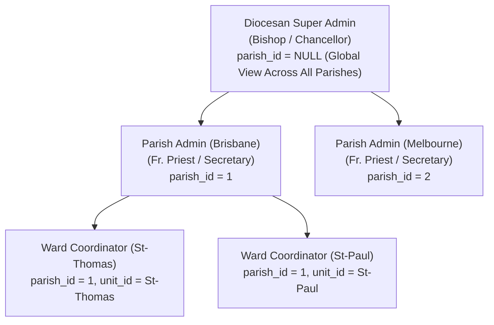
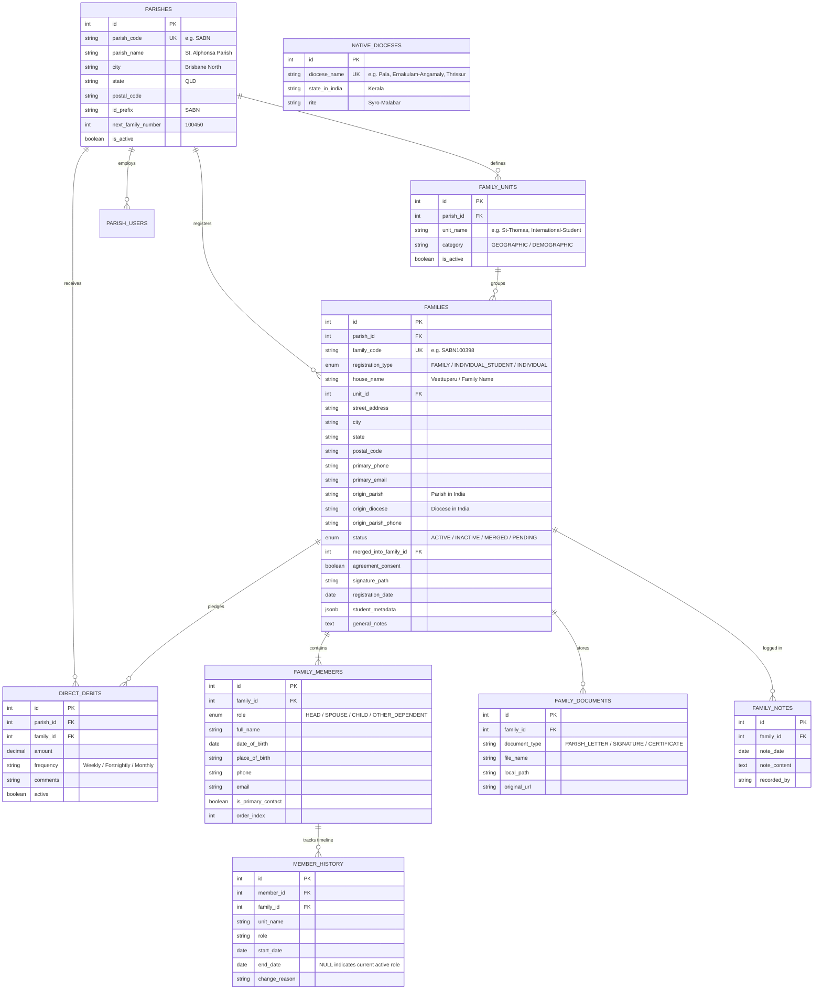
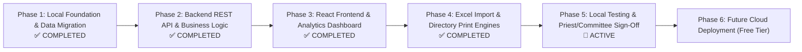

# Parish Family Register System - System Architecture & Database Design

## 1. Executive Summary & Overview
The **Parish Family Register System** is a comprehensive parishioner directory, records management, and administrative tracking application designed for Catholic parishes (initially for the Syro-Malabar Catholic Parish in Brisbane, Australia, with built-in multi-parish support for the entire Australian Diocese).

The application modernizes flat-file registration forms (WordPress Forminator exports) into an ACID-compliant, relational, and auditable system supporting:
- **Multi-Parish Architecture (Multi-Tenancy)**: Ready for diocese-wide deployment where multiple parishes run on the same platform with complete data isolation.
- **Traditional Family Registrations**: Normalized structure for Head, Spouse, Children, and Dependents.
- **Individual Students & Singles**: Independent 1-person household records capable of sharing physical residential addresses without data collision.
- **Temporal & Lifecycle Tracking**: Preserving parishioner historical status across marriages, student-to-family transitions, and ward moves without hard deletions.
- **Executive Analytics & Visual Charts**: Interactive dashboards powered by Recharts showing generational splits (Adults vs. Kids), age cohorts, household sizes, parish timeline growth, suburban density, ward distributions, and Kerala diocese origins.
- **Document & Media Vault**: Archiving parish release letters from India and digital signatures.
- **Print & Export Engine**: A4 Single-Household Dossiers, Full Parish Register Directory Print Preview, and Excel exports.

---

## 2. Local-First Development Strategy & Docker Setup

During development and testing, the application runs **strictly on the local machine**:

```mermaid
flowchart LR
    subgraph Host PC (Windows)
        React["React Frontend (Vite + Recharts)<br/>localhost:5173"]
        Node["Node.js API (TypeScript + Prisma)<br/>localhost:5000"]
        Storage["Local Media Vault<br/>/uploads/letters/ & /uploads/signatures/"]
        
        subgraph Docker Engine (Local Container)
            DB["PostgreSQL 16 Database<br/>localhost:5432<br/>Mounted Volume: ./postgres_data"]
        end
        
        React <-->|REST / JSON| Node
        Node <-->|Port 5432| DB
        Node --> Storage
    end
```

### Docker Compose Configuration (`docker-compose.yml`)
PostgreSQL 16 runs isolated inside Docker, persisting data to the local `./postgres_data` folder on Windows:

```yaml
version: '3.8'

services:
  postgres:
    image: postgres:16-alpine
    container_name: parish-postgres
    restart: always
    environment:
      POSTGRES_USER: postgres
      POSTGRES_PASSWORD: password123
      POSTGRES_DB: parish_register
    ports:
      - "5432:5432"
    volumes:
      - ./postgres_data:/var/lib/postgresql/data
```

---

## 3. High-Level Multi-Tenant Architecture

```mermaid
flowchart TD
    subgraph Global Master
        ND[("native_dioceses<br/>(Dioceses in India: Pala, Ernakulam, Thrissur...)<br/>Shared by all parishes")]
    end

    subgraph Multi-Parish Tenant Layer
        P[("parishes<br/>(Parish Master: Brisbane SABN, Melbourne SMEL...)")]
    end

    subgraph Parish-Scoped Entities (parish_id)
        U[("family_units<br/>(Wards / Units)")]
        F[("families<br/>(Households / Files)")]
        PU[("parish_users<br/>(Priests, Staff, Unit Reps)")]
        DD[("direct_debits<br/>(Parish Finances)")]
    end

    subgraph Household-Scoped Entities (family_id)
        FM["family_members<br/>(People: Head, Spouse, Children, Individuals)"]
        FD["family_documents<br/>(Letters & Signatures)"]
        FN["family_notes<br/>(Audit Log / Remarks)"]
        MH["member_history<br/>(Temporal Timeline)"]
    end

    P -->|parish_id| U
    P -->|parish_id| F
    P -->|parish_id| PU
    P -->|parish_id| DD

    F --> FM
    F --> FD
    F --> FN
    FM --> MH
    ND -.->|referenced by| F
```

---

## 4. Multi-Tenant Role-Based Access Control (RBAC)



| Role | Scope | Permissions |
| :--- | :--- | :--- |
| **DIOCESAN_ADMIN** | All Parishes (`parish_id = NULL`) | Full diocese-wide analytics, create new parishes, assign priests. |
| **SUPER_ADMIN (Priest)** | Single Parish (`parish_id`) | Full parish control: View, Edit, Merge records, financial direct debits, ward management. |
| **PARISH_ADMIN (Secretary)** | Single Parish (`parish_id`) | Daily operations: Parish Register directory, member updates, CSV imports, document viewer. |
| **UNIT_COORDINATOR** | Single Ward (`unit_id` & `parish_id`) | View contact lists for their assigned prayer unit / ward only (no financial direct debit access). |

---

## 5. Normalized Entity Relationship Diagram (ERD)



---

## 6. Complete Prisma Schema Definition

```prisma
datasource db {
  provider = "postgresql"
  url      = env("DATABASE_URL")
}

generator client {
  provider = "prisma-client-js"
}

enum RegistrationType {
  FAMILY
  INDIVIDUAL_STUDENT
  INDIVIDUAL
}

enum MemberRole {
  HEAD
  SPOUSE
  CHILD
  OTHER_DEPENDENT
}

enum FamilyStatus {
  ACTIVE
  INACTIVE
  MERGED
  PENDING
}

enum UserRole {
  SUPER_ADMIN         // Platform Owner / Developer (Global Wildcard)
  DIOCESAN_ADMIN      // Bishop / Chancellor (Diocese-wide Governance)
  DIOCESAN_USER       // Diocesan Staff / Accountant (Read-only Aggregates)
  PARISH_SUPER_ADMIN  // Parish Priest (Supreme Parish Authority - approve registrations, block admins)
  PARISH_ADMIN        // Parish Trustees / Executive Committee (Parish Management & Finance)
  PARISH_USER         // Parish Secretary / Office Volunteer / General Users (Registrations & Daily Ops)
  WARD_USER           // Ward Coordinator / Unit Leader (Ward-Isolated Query Scope)
}

// ----------------------------------------------------
// 1. GLOBAL & TENANT MASTERS
// ----------------------------------------------------

model NativeDiocese {
  id           Int      @id @default(autoincrement())
  dioceseName  String   @unique
  stateInIndia String   @default("Kerala")
  rite         String   @default("Syro-Malabar")
  createdAt    DateTime @default(now())
}

model Parish {
  id                 Int           @id @default(autoincrement())
  parishCode         String        @unique // e.g. "SABN", "SMEL"
  parishName         String        // "St. Alphonsa Syro-Malabar Parish"
  city               String        // "Brisbane North"
  state              String        // "QLD"
  postalCode         String?
  contactEmail       String?
  contactPhone       String?
  idPrefix           String        @default("SABN")
  nextFamilyNumber   Int           @default(100001)
  isActive           Boolean       @default(true)

  // Scoped Relations
  units              FamilyUnit[]
  families           Family[]
  users              ParishUser[]
  directDebits       DirectDebit[]

  createdAt          DateTime      @default(now())
  updatedAt          DateTime      @updatedAt
}

// ----------------------------------------------------
// 2. USERS & ACCESS CONTROL
// ----------------------------------------------------

model ParishUser {
  id             Int         @id @default(autoincrement())
  parishId       Int?        // NULL for Diocesan Admins
  parish         Parish?     @relation(fields: [parishId], references: [id])
  fullName       String
  email          String      @unique
  passwordHash   String
  role           UserRole    @default(PARISH_ADMIN)
  assignedUnitId Int?        // For Unit Coordinators
  unit           FamilyUnit? @relation(fields: [assignedUnitId], references: [id])
  isActive       Boolean     @default(true)

  createdAt      DateTime    @default(now())
  updatedAt      DateTime    @updatedAt
}

// ----------------------------------------------------
// 3. PARISH ENTITIES (Scoped by parishId)
// ----------------------------------------------------

model FamilyUnit {
  id          Int          @id @default(autoincrement())
  parishId    Int
  parish      Parish       @relation(fields: [parishId], references: [id], onDelete: Cascade)
  unitName    String       // "St-Thomas", "International-Student"
  category    String       @default("GEOGRAPHIC") // "GEOGRAPHIC" or "DEMOGRAPHIC"
  isActive    Boolean      @default(true)

  families    Family[]
  users       ParishUser[]

  createdAt   DateTime     @default(now())
  updatedAt   DateTime     @updatedAt

  @@unique([parishId, unitName])
}

model Family {
  id                 Int               @id @default(autoincrement())
  parishId           Int
  parish             Parish            @relation(fields: [parishId], references: [id], onDelete: Cascade)
  familyCode         String?           @unique // e.g. "SABN100398"
  registrationType   RegistrationType  @default(FAMILY)
  houseName          String            // Veettuperu / Family Name

  unitId             Int?
  unit               FamilyUnit?       @relation(fields: [unitId], references: [id])

  // Australian Address
  streetAddress      String?
  city               String?
  state              String?
  postalCode         String?
  primaryPhone       String?
  primaryEmail       String?

  // Roots in India
  originParish       String?
  originDiocese      String?
  originParishPhone  String?

  // Lifecycle & Status
  status             FamilyStatus      @default(ACTIVE)
  mergedIntoFamilyId Int?
  mergedIntoFamily   Family?           @relation("FamilyMerges", fields: [mergedIntoFamilyId], references: [id])
  mergedSubFamilies  Family[]          @relation("FamilyMerges")

  // Verification & Signatures
  agreementConsent   Boolean           @default(false)
  signaturePath      String?
  registrationDate   DateTime?

  // Flexible Metadata & Notes
  studentMetadata    Json?
  generalNotes       String?

  // Child collections
  members            FamilyMember[]
  documents          FamilyDocument[]
  directDebit        DirectDebit?
  notes              FamilyNote[]
  historyEntries     MemberHistory[]

  createdAt          DateTime          @default(now())
  updatedAt          DateTime          @updatedAt
}

model FamilyMember {
  id               Int             @id @default(autoincrement())
  familyId         Int
  family           Family          @relation(fields: [familyId], references: [id], onDelete: Cascade)
  role             MemberRole      @default(CHILD)
  fullName         String
  dateOfBirth      DateTime?
  placeOfBirth     String?
  phone            String?
  email            String?
  isPrimaryContact Boolean         @default(false)
  orderIndex       Int             @default(0) // 0: Head, 1: Spouse, 2+: Children

  history          MemberHistory[]
  documents        FamilyDocument[]

  createdAt        DateTime        @default(now())
  updatedAt        DateTime        @updatedAt
}

model MemberHistory {
  id           Int          @id @default(autoincrement())
  memberId     Int
  member       FamilyMember @relation(fields: [memberId], references: [id], onDelete: Cascade)
  familyId     Int
  family       Family       @relation(fields: [familyId], references: [id], onDelete: Cascade)
  unitName     String
  role         MemberRole
  startDate    DateTime     @default(now())
  endDate      DateTime?    // NULL = current active role
  changeReason String?      // e.g. "Initial student registration", "Married into SABN100398"

  createdAt    DateTime     @default(now())
}

model FamilyDocument {
  id           Int           @id @default(autoincrement())
  familyId     Int
  family       Family        @relation(fields: [familyId], references: [id], onDelete: Cascade)
  memberId     Int?
  member       FamilyMember? @relation(fields: [memberId], references: [id], onDelete: SetNull)
  documentType String        // "PARISH_LETTER", "SIGNATURE", "CERTIFICATE"
  fileName     String
  localPath    String
  originalUrl  String?
  uploadedAt   DateTime      @default(now())
}

model DirectDebit {
  id        Int      @id @default(autoincrement())
  parishId  Int
  parish    Parish   @relation(fields: [parishId], references: [id], onDelete: Cascade)
  familyId  Int      @unique
  family    Family   @relation(fields: [familyId], references: [id], onDelete: Cascade)
  amount    Decimal? @db.Decimal(10, 2)
  frequency String?  // "Weekly", "Fortnightly", "Monthly"
  comments  String?
  active    Boolean  @default(true)
  updatedAt DateTime @updatedAt
}

model FamilyNote {
  id          Int       @id @default(autoincrement())
  familyId    Int
  family      Family    @relation(fields: [familyId], references: [id], onDelete: Cascade)
  noteDate    DateTime?
  noteContent String
  recordedBy  String?
  createdAt   DateTime  @default(now())
}

model RolePermission {
  id          Int       @id @default(autoincrement())
  role        UserRole
  module      String    // e.g. "DASHBOARD", "FAMILIES", "MEMBERS", "USERS", "UNITS", "FINANCE"
  canView     Boolean   @default(true)
  canCreate   Boolean   @default(false)
  canEdit     Boolean   @default(false)
  canArchive  Boolean   @default(false)
  canDelete   Boolean   @default(false)
  canExport   Boolean   @default(false)
  updatedAt   DateTime  @updatedAt

  @@unique([role, module])
}

model UserPermissionOverride {
  id          Int        @id @default(autoincrement())
  userId      Int
  user        ParishUser @relation(fields: [userId], references: [id], onDelete: Cascade)
  module      String
  canView     Boolean?
  canCreate   Boolean?
  canEdit     Boolean?
  canArchive  Boolean?
  canDelete   Boolean?
  canExport   Boolean?
  updatedAt   DateTime   @updatedAt

  @@unique([userId, module])
}
```

---

## 7. Complete Project Implementation Phases



| Phase | Milestone | Scope & Deliverables |
| :--- | :--- | :--- |
| **Phase 1** | **Local Foundation & Data Migration** | ✅ **COMPLETED**: PostgreSQL in Docker, Prisma migrations, 497 families & 1,626 members ingested, Prisma Studio tested. |
| **Phase 2** | **Backend REST API & Logic** | ✅ **COMPLETED**: Express API on port 5000, JWT Auth, Active Parish Middleware, Dashboard stats, demographic aggregations, and Parish Register search API. |
| **Phase 3** | **React Frontend & Modern Dashboard** | • **Sub-Phase 3.1: Design System & Shell** (✅ **COMPLETED**: Warm Linen & Sacred Green tokens, reusable `<Button>`, `<Badge>`, `<Input>`, `<Modal>`, `<Drawer>`, `<ConfirmDialog>`, locked parish badge).<br/>• **Sub-Phase 3.2: Auth & Protected Routes** (✅ **COMPLETED**: Clean `/login` screen without pre-login parish picker, intermediate parish selector for global admin roles, `AuthContext` with JWT persistence, `ProtectedRoute` guards, automatic `x-parish-id` header).<br/>• **Sub-Phase 3.3: Master Data Screens & RBAC Matrix** (✅ **COMPLETED**: Wards `/units` with live add/edit modals; Users & Access Rights `/users` with 3 sub-tabs: Authorized Users table & mobile cards, Role Permissions Matrix across 8 modules, and Granular User Overrides with strict Ward Coordinator database isolation. Automatic logged-in parish inheritance).<br/>• **Sub-Phase 3.4: Executive Dashboard** (✅ **COMPLETED**: 5 People/Community KPI cards, Recharts suite with 7 vibrant charts: Adults vs. Kids Donut, Household Types Donut, Age Generations Column Bar, Household Size Frequency Column Bar, Registration Timeline Gradient Area, Top Suburbs Horizontal Bar, Ward Jurisdictions Rainbow Bar, and Kerala Dioceses Ranked List).<br/>• **Sub-Phase 3.5: Parish Register Directory & Drawer** (✅ **COMPLETED**: Live searchable directory, priority Family Head first with house name underneath, multi-filter by ward/status/type, slide-over `<Drawer>` with member breakdown, and mobile responsive card view).<br/>• **Sub-Phase 3.6: Registration Wizard & Merge** (✅ **COMPLETED**: Multi-step registration forms `/register/new`, dynamic child repeater, non-destructive marriage merge). |
| **Phase 4** | **Import / Export Tools & Print Engines** | ✅ **COMPLETED**: Drag-and-drop Forminator XLSX/CSV importer (`/import`), Full Directory Excel export, Household Dossier A4 Print Engine with Formatted Colour & B&W Ink-Saver themes, and Multi-page Parish Register Directory Print Preview. |
| **Phase 5** | **Local Testing & UAT** | 🔄 **ACTIVE**: End-to-end acceptance testing strictly on `localhost`. Validation with parish committee and data sanity verification. |
| **Phase 6** | **Future Cloud Deployment** | • Push to private GitHub.<br/>• Deploy to Supabase (PostgreSQL in Sydney, Australia) + Vercel with automated SSL for zero cost. |


