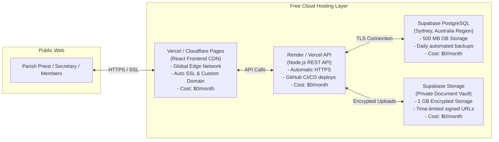

# Parish Family Register System - Technical Specification & Hosting Architecture

## 1. System Overview & Technology Philosophy
The **Parish Family Register System** is designed with three core engineering principles:
1. **Zero-Cost & Open-Source Foundation**: Built entirely on industry-standard, open-source technologies with no proprietary licensing fees or vendor lock-in.
2. **Local-First Development & Testing**: Completely isolated and fully functional on the developer's local machine without relying on external internet connectivity or cloud databases.
3. **Enterprise-Grade Security & Australian Privacy**: Engineered to meet Australian privacy principles with end-to-end encryption, strict access control, and Australian data residency (Sydney region).

---

## 2. Technology Stack & Component Scope

```mermaid
flowchart TD
    subgraph Frontend Tier (Client)
        R["React 18 + Vite (SPA)"]
        TW["Tailwind CSS (Styling)"]
        UI["shadcn/ui + Radix UI (Accessible Components)"]
        CH["Recharts (Executive Animated Visualizations)"]
        IC["Lucide React (Icon System)"]
        R --- TW
        R --- UI
        R --- CH
        R --- IC
    end

    subgraph Backend Tier (API Server)
        NODE["Node.js LTS + TypeScript"]
        EXP["Express.js (REST API Routing)"]
        PRISMA["Prisma ORM (Type-Safe Database Access)"]
        ZOD["Zod (Schema & Input Validation)"]
        AUTH["JSON Web Tokens (JWT) + Bcrypt"]
        CSV["csv-parse (Data Ingestion & Migration)"]
        NODE --- EXP
        NODE --- PRISMA
        NODE --- ZOD
        NODE --- AUTH
        NODE --- CSV
    end

    subgraph Database & Persistence Tier
        PG[("PostgreSQL 16 Relational Database")]
        DOCS["Local / Cloud Object Storage (Signatures & PDFs)"]
    end

    Frontend Tier <-->|RESTful JSON / HTTPS| Backend Tier
    Backend Tier <-->|Connection Pool / Port 5432| Database & Persistence Tier
```

---

### 2.1 Frontend Technologies (Client)

| Technology | Version / Tool | Scope in System | Key Benefits |
| :--- | :--- | :--- | :--- |
| **React** | `v18.x` | Core UI Framework | Component-based architecture, declarative state management, fast rendering with virtual DOM. |
| **Vite** | `v5.x / v6.x` | Build Tool & Bundler | Instant Hot Module Replacement (HMR), sub-second local startup, optimized production bundles via Rollup. |
| **TypeScript** | `v5.x` | Language | Strict type-safety matching backend Prisma models; catches bugs at compile time. |
| **Tailwind CSS** | `v3.x / v4.x` | Design Token Engine | Utility CSS powered by centralized CSS custom properties (`:root { --primary: ... }`) for instant site-wide theme switching. |
| **Component Library** | Custom Reusable | Button & Modal System | Centralized `<Button>`, `<Modal>`, `<Drawer>`, and `<ConfirmDialog>` components. Zero duplicate popup or button code. |
| **Recharts** | `v2.x` | Data Visualizations | Native React SVG charting; smooth animations, responsive tooltips, donut charts for wards, and bar charts for dioceses. |
| **Lucide React** | `v0.x` | Icon Library | Over 1,000 clean, consistent vector icons for UI navigation and status indicators. |
| **Axios / TanStack Query** | Latest | API & Data Fetching | Cached server-state management, automatic refetching, and clean request/response interceptors for auth tokens. |

---

### 2.1.1 Centralized Design System & Theming Tokens

To enable instantaneous app-wide theme changes and prevent inline style duplication, all colors are defined as **CSS Custom Properties (Variables)** in `client/src/index.css`.

#### Default Parish Theme: Warm Beige & Sacred Green

```css
:root {
  /* Warm Beige / Sand Canvas */
  --bg-app: #fbf9f4;            /* Soft Cream/Beige Page Background */
  --bg-surface: #ffffff;        /* Crisp White Card/Table Surface */
  --bg-surface-subtle: #f4efe6; /* Sand Beige Muted Containers */
  --border-color: #e5decf;      /* Warm Warm Stone Borders */

  /* Liturgical / Deep Forest Green */
  --primary: #1b4332;           /* Deep Forest Green (Primary Brand) */
  --primary-hover: #143527;     /* Darker Shade on Hover */
  --primary-light: #e8f3ed;     /* Soft Mint/Sage Tint for Badges */
  --primary-foreground: #ffffff;/* White text on Primary buttons */

  /* Accent & Status */
  --accent-gold: #c69214;       /* Traditional Parish Warm Gold */
  --text-main: #1c2420;         /* Charcoal Forest Main Text */
  --text-muted: #627267;        /* Soft Sage Secondary Text */
  --danger: #b91c1c;            /* Clean Ruby Red for Warnings */
}
```

*Changing the entire application theme (e.g. Dark Mode, Navy & Gold, or Burgundy) requires editing only these variables in one central CSS file.*

---

### 2.1.2 Atomic Reusable UI Components

All interactive elements are isolated in `client/src/components/ui/` with zero inline CSS:

1. **`<Button variant="..." size="..." isLoading={...} icon={...}>`**:
   - Variants: `primary` (Forest Green), `secondary` (Beige/Muted), `outline`, `ghost`, `danger`.
   - Built-in loading spinner, disabled states, and keyboard focus rings.
2. **`<Modal isOpen={...} onClose={...} title="..." description="...">`**:
   - Universal backdrop, smooth scale-in animation, escape key listener, and accessible focus trap.
3. **`<Drawer isOpen={...} onClose={...}>`**:
   - Slide-over drawer for viewing full family and student profiles without navigating away.
4. **`<ConfirmDialog onConfirm={...} title="..." message="...">`**:
   - Standard confirmation for merging students, transferring wards, or archiving records.


---

### 2.1.3 Modern SaaS Website Aesthetic & Interaction Design

To ensure the application feels like a modern executive SaaS tool (inspired by platforms like Linear, Stripe, and Apple) rather than a legacy boxy parish portal:

1. **Frosted Glass Navigation**:
   - Sticky top navigation bar with translucent blur (`backdrop-blur-md bg-[#fbf9f4]/80`).
   - Parish switcher dropdown positioned prominently on the top bar: `[ Select Parish: St. Alphonsa Brisbane (SABN) ▼ ]`.
2. **Card & Surface Architecture**:
   - Soft, multi-layered ambient shadows (`shadow-sm` on rest, `shadow-md` on hover).
   - Hairline translucent borders (`border border-emerald-950/5 hover:border-emerald-950/15`).
   - Generous whitespace and padding to eliminate visual density.
3. **Micro-Interactions & Modals**:
   - Tactile button depressions on click (`active:scale-[0.98] transition-transform`).
   - **Slide-Over Drawers** rather than full-page jumps: Clicking a family in the directory slides open a detail drawer from the right, keeping the user in their search flow.
   - Clean keyboard shortcuts (`Ctrl + K` / `Cmd + K` for global parishioner search).

---

### 2.1.4 Active Parish Context & Tenant Switching

For multi-tenant diocese-wide operations:
1. **Diocesan Super Admin (`royvantony@gmail.com`)**:
   - Carries `parish_id = NULL` in the database (global authority).
   - Automatically defaults to **St. Alphonsa Brisbane (`id = 1`)** on login.
   - Can select any parish from the top navbar dropdown, sending `x-parish-id` in API headers to instantly switch context.
2. **Parish-Level Users (Priest / Secretary)**:
   - Locked strictly to their assigned `parish_id`. The backend rejects or ignores cross-parish header tampering.

---

### 2.2 Backend Technologies (Server)


| Technology | Scope in System | Key Benefits |
| :--- | :--- | :--- |
| **Node.js** (`v24 LTS`) | JavaScript Runtime | High-throughput asynchronous I/O, large open-source ecosystem, shared TypeScript models with frontend. |
| **Express.js** | Web Framework | Lightweight, modular REST routing, robust middleware pipeline for authentication, logging, and error handling. |
| **TypeScript** | Backend Language | Full type safety across routes, request payloads, database queries, and response models. |
| **Prisma ORM** | Object-Relational Mapper | Auto-generates type-safe database client from `schema.prisma`. Handles declarative schema migrations (`prisma migrate`) and visual database inspection (`prisma studio`). |
| **Zod** | Validation Engine | Runtime schema validation for incoming JSON payloads; guarantees no corrupted data enters the database. |
| **Bcrypt** | Password Security | Industry-standard salted key-derivation function (hashing) for parish staff passwords; protects against brute-force attacks. |
| **JSON Web Tokens (JWT)** | Authentication | Stateless session management with role-based claims (`SUPER_ADMIN`, `PARISH_ADMIN`, `UNIT_COORDINATOR`). |
| **csv-parse** | Data Processing | Stream-based parser to ingest legacy WordPress Forminator CSV exports with automatic date/phone cleansing. |

---

### 2.4 Pre-Configured Administrative Accounts

| Account / Role | Email | Default Password | Permissions Scope |
| :--- | :--- | :--- | :--- |
| **Diocesan Super Admin** | `royvantony@gmail.com` | `DevSuperAdmin2026!` | **Global (`parish_id = NULL`)**: Full diocese-wide access, can switch across all parishes, manage parishes, priests, and system settings. |
| **Super Admin (Parish Priest)** | `priest@stalphonsabrisbane.org.au` | `parishAdmin2026!` | **Parish-Level (`parish_id = 1`)**: Full control over St. Alphonsa Brisbane parish records, financials, and unit allocations. |
| **Parish Admin (Secretary)** | `secretary@stalphonsabrisbane.org.au` | `parishAdmin2026!` | **Parish-Level (`parish_id = 1`)**: Day-to-day operations, parish register search, family/member updates, and CSV imports. |


---

### 2.3 Database Tier (PostgreSQL 16)

PostgreSQL was selected over MySQL, MongoDB, and SQLite for critical church registry capabilities:

1. **ACID Reliability**: Transactions guarantee that adding a family with members, history, and documents commits atomically—either 100% successful or rolled back.
2. **Partial Unique Indexes**:
   ```sql
   CREATE UNIQUE INDEX unique_family_head ON family_members (family_id) WHERE role = 'HEAD';
   ```
   Enforces at the database engine level that no household can ever accidentally have two heads of family.
3. **Fuzzy Search (`pg_trgm`)**: Native trigram matching allows parish secretaries to search Kerala family house names even with spelling mistakes (e.g. searching *"Pezhathumootil"* matches *"Peazhathummoottil House"*).
4. **JSONB Support**: Stores flexible metadata (such as student university or course info) inside relational records without changing table structures.
5. **No Size Caps or Artificial Throttling**: 100% free under the PostgreSQL Open Source License.

---

## 3. Local Development Environment (Phase 1 to 5)

During the development and user acceptance testing (UAT) phase, the entire platform runs on the user's local PC:

```
[Local Browser: http://localhost:5173] (React Frontend)
                   │
                   ▼ HTTP REST
[Local Node API: http://localhost:5000] (Express Server)
                   │
                   ▼ Port 5432
[Docker Engine: parish-postgres container] (PostgreSQL 16)
                   │
                   ▼ Persistent Bind Mount
[Windows File System: ./postgres_data & ./uploads]
```

### Benefits of the Local Docker Setup:
- **Zero OS Clutter**: PostgreSQL runs inside an isolated container without modifying the Windows Registry or creating background Windows services.
- **Data Persistence**: Database data is saved to `c:\Dev\PARISH_REGISTER\postgres_data`. Shutting down the container or restarting your PC preserves all data.
- **Portability**: The exact same container runs on any developer PC (Windows, macOS, Linux) with identical behavior.

---

## 4. Production Hosting Architecture (Zero-Cost Plan)

When local acceptance testing is complete, the application can be deployed to the cloud for **$0/month** while providing enterprise security and reliability:



### 4.1 Hosting Breakdown & Capacity Comparison

| Service | Provider | Region | Free Tier Allocation | Estimated Parish Usage |
| :--- | :--- | :--- | :--- | :--- |
| **Frontend CDN** | Vercel / Cloudflare | Global Edge | Unlimited bandwidth for non-profits | ~5 GB / month |
| **Backend API** | Render / Vercel Functions | Oregon / Sydney | Free web service with HTTPS | ~50,000 monthly requests |
| **Database** | Supabase (PostgreSQL 16) | **Sydney (Australia)** | **500 MB** Database Storage | ~20 MB (for 10,000+ parishioners) |
| **Document Vault** | Supabase Storage | **Sydney (Australia)** | **1,000 MB (1 GB)** Storage | ~150 MB (compressed letters & signs) |
| **Custom Domain** | Parish Domain DNS | Global | Free SSL certificates (Let's Encrypt) | `register.stalphonsabrisbane.org.au` |

---

## 5. Security & Privacy Safeguards

Given that this application stores sensitive personal records (names, dates of birth, home addresses, phone numbers, signatures, and parish release letters):

1. **Australian Data Residency**: Production database is hosted in the **Sydney (ap-southeast-2)** cloud region, complying with Australian data privacy recommendations.
2. **Encryption in Transit**: All communication uses modern **TLS 1.3 / HTTPS**. Plain HTTP is permanently rejected.
3. **Encryption at Rest**: PostgreSQL database volumes and file vaults are encrypted at rest using industry-standard **AES-256**.
4. **Protected Media Vault**: Uploaded parish release letters and digital signatures are stored in a **Private Bucket**. Unlike the legacy WordPress upload folder (which exposed public URLs), documents in this system can only be viewed via short-lived, cryptographically signed URLs accessible by authorized parish staff.
5. **Multi-Tenant Data Isolation**: Database queries enforce `parish_id` scoping at the ORM layer, preventing any unauthorized cross-parish data leaks if additional parishes join the platform.

---

## 6. Developer Operations & Task Management Guide

This section explains how to start, inspect, and stop all components and background tasks across your local development environment.

### 6.1 Managing the PostgreSQL Database (Docker)

All database commands are run from the project root directory: `c:\Dev\PARISH_REGISTER`.

| Action | Command | Description |
| :--- | :--- | :--- |
| **Start Database** | `docker compose up -d` | Boots the `parish-postgres` container in the background on port `5432`. |
| **Check Status** | `docker ps` | Verifies if `parish-postgres` is running healthy (`Up X minutes`). |
| **Stop Database** | `docker compose stop` | Pauses the database without deleting any containers or data. |
| **Restart Database** | `docker compose restart` | Quick restart if connections get stuck. |
| **Tear Down** | `docker compose down` | Stops and removes the container. **Note**: Your database records remain 100% safe because data is persisted to `./postgres_data` on your hard drive. |

---

### 6.2 Managing Prisma Studio (Database Visualizer)

Prisma Studio runs a local web interface on `http://localhost:5555` to view and edit tables like a spreadsheet.

Commands are run from the server directory: `c:\Dev\PARISH_REGISTER\server`.

| Action | Command | Description |
| :--- | :--- | :--- |
| **Start Prisma Studio** | `npm run studio` | Launches Prisma Studio on `http://localhost:5555`. |
| **Stop Prisma Studio** | Press `Ctrl + C` | Stops the local web server and frees port `5555`. |

---

### 6.3 Managing the Backend Server (Phase 2)

Commands are run from the server directory: `c:\Dev\PARISH_REGISTER\server`.

| Action | Command | Description |
| :--- | :--- | :--- |
| **Start API Server** | `npm run dev` | Launches the Express API on `http://localhost:5000` with hot-reloading via `tsx watch`. |
| **Stop API Server** | Press `Ctrl + C` | Terminates the Node.js API process. |

---

### 6.4 Managing the React Frontend (Phase 3)

Commands are run from the client directory: `c:\Dev\PARISH_REGISTER\client`.

| Action | Command | Description |
| :--- | :--- | :--- |
| **Start Dev Server** | `npm run dev` | Launches Vite dev server with Hot Module Replacement (HMR) on `http://localhost:5173`. |
| **Build for Production** | `npm run build` | Compiles TypeScript and builds optimized production bundles into `/client/dist`. |
| **Preview Production Build** | `npm run preview` | Spins up a local static server to test the production build on `http://localhost:4173`. |
| **Stop Frontend Server** | Press `Ctrl + C` | Terminates the Vite dev server. |

---

### 6.5 Running Data Migration & Inspection Scripts

From `c:\Dev\PARISH_REGISTER\server`:

| Task | Command | Description |
| :--- | :--- | :--- |
| **View Parish Register Audit Summary** | `npx tsx scripts/summary.ts` | Prints instant console summary of all families, members, wards, and notes. |
| **Re-seed Masters & Admin Logins** | `npm run db:seed` | Re-seeds Brisbane Parish, Indian Dioceses, and Admin/Dev credentials. |
| **Re-run CSV Migration** | `npm run import:csv` | Parses and re-imports the CSV file from `/data`. |
| **Clean Duplicate Student Members** | `npx tsx scripts/clean-duplicate-students.ts` | Removes any duplicate spouse/children with identical names in student rows. |

---

## 7. Frontend Design System & UI Architecture (Phase 3.1)

### 7.1 Centralized CSS Variable Theming
All color tokens, radii, shadows, and fonts are centralized in [client/src/index.css](file:///c:/Dev/PARISH_REGISTER/client/src/index.css) as CSS custom properties. No hardcoded inline hex colors are used in component files. Swapping the entire color scheme or implementing dark/contrast themes in the future requires editing only these token definitions:

| Token | CSS Variable | Default Value | Role / Usage |
| :--- | :--- | :--- | :--- |
| **Canvas Background** | `--color-linen-canvas` | `#fbf9f4` | Warm, elegant linen beige page canvas |
| **Card Surface** | `--color-linen-card` | `#ffffff` | Pure white crisp elevated card backgrounds |
| **Subtle Neutral Surface**| `--color-linen-subtle` | `#f4f0e6` | Muted background for tables, headers & pills |
| **Border Soft** | `--color-linen-border` | `#e7e0d3` | Gentle warm dividing borders |
| **Primary Brand** | `--color-sacred-primary` | `#1b4332` | Deep Sacred Forest Green for primary actions |
| **Primary Hover** | `--color-sacred-hover` | `#2d6a4f` | Interactive hover state for buttons & active nav |
| **Brand Tint / Light** | `--color-sacred-light` | `#e8ede9` | Soft green accent background for badges & highlights |
| **Text Primary** | `--color-linen-dark` | `#1c1917` | Deep slate for high-contrast legible headings |
| **Text Muted** | `--color-linen-muted` | `#6b7280` | Subtle gray for labels, timestamps, and helpers |

### 7.2 Reusable Atomic UI Component Library
The UI is built with a strictly reusable atomic design system in `client/src/components/ui`:

1. **`<Button>`** ([Button.tsx](file:///c:/Dev/PARISH_REGISTER/client/src/components/ui/Button.tsx)):
   - **Variants**: `primary` (Sacred Green), `secondary` (warm beige fill), `outline` (linen border), `ghost` (transparent text), `danger` (crimson warning).
   - **Sizes**: `sm`, `md`, `lg`.
   - **Features**: Built-in SVG loading spinner with `isLoading`, left/right icon slots, standard accessibility focus rings.
2. **`<Badge>`** ([Badge.tsx](file:///c:/Dev/PARISH_REGISTER/client/src/components/ui/Badge.tsx)):
   - **Variants**: `success` (green), `warning` (amber), `info` (blue), `neutral` (warm gray), `danger` (red).
   - **Features**: Optional leading pulse dot indicator for live statuses (e.g. `ACTIVE`).
3. **`<Input>`** ([Input.tsx](file:///c:/Dev/PARISH_REGISTER/client/src/components/ui/Input.tsx)):
   - Floating/stacked labels, integrated helper text, error messages, and left/right icon adornments.
4. **`<Modal>`** ([Modal.tsx](file:///c:/Dev/PARISH_REGISTER/client/src/components/ui/Modal.tsx)):
   - Centered dialog with backdrop blur (`backdrop-blur-sm bg-black/40`), smooth spring animation, keyboard `ESC` dismissal, outside click dismissal, configurable size tiers (`sm`, `md`, `lg`, `xl`).
5. **`<Drawer>`** ([Drawer.tsx](file:///c:/Dev/PARISH_REGISTER/client/src/components/ui/Drawer.tsx)):
   - Modern slide-over panel sliding in from the right edge with fixed header, scrollable body, and sticky action footer. Ideal for inspecting family details and edit drawers.
6. **`<ConfirmDialog>`** ([ConfirmDialog.tsx](file:///c:/Dev/PARISH_REGISTER/client/src/components/ui/ConfirmDialog.tsx)):
   - Standardized alert popup for destructive actions (e.g., deleting a family member, archiving a record, merging families).

### 7.3 Navigation Architecture: Clean Top Bar & Collapsible Auto-Hide Sidebar
1. **`<AppNavbar>`** ([AppNavbar.tsx](file:///c:/Dev/PARISH_REGISTER/client/src/components/layout/AppNavbar.tsx)):
   - Single-tier clean frosted header (`h-16`) with responsive width (`max-w-[1440px]`).
   - **Active Parish Switcher**: Direct dropdown switcher for diocesan admins (`DIOCESAN_ADMIN`) to toggle across parishes in Australia (`x-parish-id` header).
   - **Quick Global Search**: Fast lookup input with `⌘K` keyboard shortcut.
   - **User Profile Pill & Sign Out**: Displays authenticated user (`Super Admin`) and role badge with one-click logout.

2. **`<AppSidebar>`** ([AppSidebar.tsx](file:///c:/Dev/PARISH_REGISTER/client/src/components/layout/AppSidebar.tsx)):
   - **Integrated Collapse Button**: Dedicated toggle button (`PanelLeftClose` / `PanelLeftOpen`) placed inside the sidebar's top header row, keeping the top navbar uncluttered.
   - **Collapsible States**: Full width (`w-64` / 256px) or collapsed mini rail (`w-18` / 72px) with floating tooltips and smooth CSS transitions.
   - **Main Menu**: Categorized links for **Dashboard** (default selected and highlighted), **Parish Register** (`73`), **Register New Family** (standard menu item with icon), **Wards & Units** (`8`), **Users & Roles**, and **Settings**.
   - **Productive Lower Area (Parish Pulse Widget)**:
     - **Live Vital Counters**: 2x2 statistics grid displaying 73 Families, 147 Members, 8 Wards, and 31 Direct Debit Pledges (operational data relevant to Brisbane parish life).
     - **Database Health**: Live indicator showing PostgreSQL 16 container status on port 5432.
     - **Pastoral Support Callout**: Direct Brisbane North Parish office contact helper.
     - **Bottom Collapse Toggle**: Accessible secondary toggle button at the bottom of the sidebar.

### 7.4 Unified Terminology
The term **Parish Register** is universally adopted across the application UI, top navbar search, global shortcuts, and technical documentation, completely replacing the term "Census".

---

## 8. Authentication & Protected Routes Architecture (Sub-Phase 3.2)

### 8.1 JWT Session Management & Active Parish Context
The frontend authenticates against the Express backend (`POST /api/auth/login`) using the centralized [`AuthContext.tsx`](file:///c:/Dev/PARISH_REGISTER/client/src/context/AuthContext.tsx) and Axios interceptor in [`api.ts`](file:///c:/Dev/PARISH_REGISTER/client/src/lib/api.ts):

1. **Storage**:
   - `parish_token`: Secure JWT issued by the server (7-day lifespan).
   - `parish_user`: Serialized user object (`id`, `fullName`, `email`, `role`, `parishId`).
   - `parish_active_id`: Currently selected parish ID for tenant scoping (default: `1` for Brisbane SABN).
2. **Automatic Header Injection**:
   - Every outgoing HTTP request automatically includes:
     - `Authorization: Bearer <parish_token>`
     - `x-parish-id: <parish_active_id>`
3. **Session Verification (`/api/auth/me`)**:
   - On page load, `AuthProvider` validates the token with the server. If expired or revoked, localStorage is wiped and the visitor is redirected to `/login`.

### 8.2 Diocesan Super Admin Working Parish Selector
Because the Diocesan Super Admin (`royvantony@gmail.com`) possesses global jurisdiction without a hardcoded parish assignment (`parishId = NULL`), the login screen ([`Login.tsx`](file:///c:/Dev/PARISH_REGISTER/client/src/pages/Login.tsx)) dynamically presents a **Working Parish Context** selector. When logging in, the Super Admin selects their working parish, ensuring all subsequent family creations, census updates, and financial notes route to the intended parish database scope.

### 8.3 Route Protection & Layout
Routes are managed by `react-router-dom` in [`App.tsx`](file:///c:/Dev/PARISH_REGISTER/client/src/App.tsx):
- **Public**: `/login` ([`Login.tsx`](file:///c:/Dev/PARISH_REGISTER/client/src/pages/Login.tsx)) featuring one-click demo credentials for Super Admin, Priest, and Secretary.
- **Protected Layout** ([`AppLayout.tsx`](file:///c:/Dev/PARISH_REGISTER/client/src/components/layout/AppLayout.tsx)):
  - Enforced by [`ProtectedRoute.tsx`](file:///c:/Dev/PARISH_REGISTER/client/src/components/auth/ProtectedRoute.tsx).
  - Routes: `/dashboard`, `/register`, `/register/new`, `/units`, `/users`, `/settings`.
  - Unauthenticated access redirects automatically to `/login`.

### 8.4 Mobile-First Responsive Design Principles
The entire frontend is engineered following strict reactive design guidelines across all viewport sizes (smartphones 375px–430px, tablets 768px–1024px, and desktop displays):

1. **Touch-First Accessibility**:
   - All interactive controls, buttons, and navigation pills enforce a minimum touch target of **44x44px** for iOS Safari and Android Chrome compatibility.
2. **Reactive Navigation Architecture**:
   - **Desktop (≥ 768px)**: Collapsible left sidebar (`w-64` / `w-18`) with compact pulse statistics.
   - **Mobile (< 768px)**: The left sidebar auto-hides; the top navbar exposes a reactive **hamburger menu toggle** (`Menu` / `X`) that opens an animated, full-height slide-over drawer with the complete navigation hierarchy, parish pulse counters, and active session sign-out.
3. **Adaptive Modals & Slide-Over Drawers**:
   - Slide-over drawers ([`Drawer.tsx`](file:///c:/Dev/PARISH_REGISTER/client/src/components/ui/Drawer.tsx)) automatically adapt from standard widths (`max-w-md`, `max-w-lg`) down to `max-w-full pl-0` on mobile viewports so content is never cropped on narrow screens.
   - Centered modals ([`Modal.tsx`](file:///c:/Dev/PARISH_REGISTER/client/src/components/ui/Modal.tsx)) feature responsive padding (`p-4 sm:p-6`) and viewport-constrained bounds (`max-w-[92vw] sm:max-w-lg`).
   - **Persistent Edit Protection**: Backdrop clicks (`closeOnBackdropClick = false`) and ESC key dismissing are disabled across all modals and drawers by default. Popups can only be dismissed deliberately via the explicit top-right `X` close button or form "Cancel" action, eliminating accidental data loss when clicking outside the dialog while typing.
4. **Fluid Grids & Data Tables**:
   - Dashboard metric cards and ward cards collapse from `grid-cols-4` on desktop to `grid-cols-2` on tablet and `grid-cols-1` on smartphone.
   - All data tables are wrapped in responsive horizontal scrolling containers (`overflow-x-auto`) with subtle scrollbars to prevent horizontal page clipping.
5. **Session Inactivity Timeout & Pre-Logout Warning**:
   - Configured in [`client/src/context/AuthContext.tsx`](file:///c:/Dev/PARISH_REGISTER/client/src/context/AuthContext.tsx#L33) via `export const INACTIVITY_TIMEOUT_MINUTES = 5` (set to 5m for testing; default production 30m) and `export const WARNING_BEFORE_LOGOUT_SECONDS = 60` (warning popup appears 60s before timeout).
   - Monitored continuously via 1-second interval loop with throttled user activity listeners.
   - When 60 seconds remain, [`SessionTimeoutWarningModal.tsx`](file:///c:/Dev/PARISH_REGISTER/client/src/components/auth/SessionTimeoutWarningModal.tsx) pops up with a live MM:SS ticking clock and two actions:
     - **Stay Signed In**: Immediately resets idle timer back to 0 and closes the modal.
     - **Sign Out Now**: Immediately terminates session and redirects to `/login`.
   - If countdown reaches `00:00`, session is wiped and `/login` displays an alert banner explaining the automatic sign-out.

---

## 9. Master Data, Live Dashboard & Parish Register Implementation (Sub-Phases 3.3 – 3.5)

### 9.1 Family Units / Wards Management (`/units`)
- **Backend API**: `GET /api/masters/units`, `POST /api/masters/units`, and `PATCH /api/masters/units/:id`.
- **Card-Based Grid**: Responsive layout (`grid-cols-1 sm:grid-cols-2 lg:grid-cols-3 xl:grid-cols-4`) displaying prayer ward names, category badges (`GEOGRAPHIC` vs. `DEMOGRAPHIC`), family counts, and active status.
- **Interactive Modals**:
  - Add New Ward Modal with validation and immediate data refresh.
  - Edit Ward Modal with active state toggle and name editing.
- **Category Filter Pills**: 1-click filtering between All, Geographic, and Demographic wards.

### 9.2 Users & Access Control (`/users`)
- **Backend API**: `GET /api/masters/users`, `POST /api/masters/users`, `PATCH /api/masters/users/:id` (profile/role edit), and `PATCH /api/masters/users/:id/toggle-status`.
- **Parish-Centric 4-Role UI (Diocesan & Developer Hidden)**:
  - **1. Parish Super Admin** (`PARISH_SUPER_ADMIN`): Parish Priest (supreme parish authority - can approve pending family registrations, block/deactivate parish admins, full finance & user management).
  - **2. Parish Admin** (`PARISH_ADMIN`): Parish Trustees / Executive Committee (parish management, direct debit finance, user management below them).
  - **3. Parish User** (`PARISH_USER`): Parish Secretary / Office Volunteer / General Users (daily registrations, no direct debit finance, no user management).
  - **4. Ward User** (`WARD_USER`): Ward Coordinator / Unit Leader (ward-isolated query scope, no financial data).
  *(Note: Platform Developer `SUPER_ADMIN` and `DIOCESAN_*` roles are preserved in the database schema for future multi-parish deployments, but are completely hidden from parish UI lists, filter pills, and invite modals).*
- **Mobile-Adaptive Presentation**:
  - **Mobile (< 768px)**: Renders a clean card list with avatar initials, role badge, email link, assigned ward/parish, and action controls (Edit, Permissions, Activate/Deactivate).
  - **Desktop (≥ 768px)**: Renders a tabular data view with user avatars, roles, jurisdictions, and action controls.
- **Create User Modal**: Form with Bcrypt password hashing, role selection strictly across the 4 active Parish roles, one-click WhatsApp/SMS copy, and unit assignment selector for Ward Users.
- **Edit User Modal**: Allows editing only editable attributes (Full Name, Role assignment, Ward Jurisdiction for Ward Users, and optional password reset). Fixed system identifiers (Login Email and Parish Jurisdiction) remain strictly locked and read-only. Role change is restricted based on hierarchy (users cannot change their own role, lower roles cannot promote to higher tiers).
- **Deactivate/Activate Action**: Enforces hierarchy checks (lower roles cannot deactivate superiors, Super Admin cannot be deactivated from UI) and uses [`ConfirmDialog.tsx`](file:///c:/Dev/PARISH_REGISTER/client/src/components/ui/ConfirmDialog.tsx) to prevent accidental credential revocation.

### 9.3 Live Executive Dashboard (`/dashboard`)
- **Backend API**: `GET /api/dashboard/stats` and `GET /api/dashboard/charts`.
- **Live KPI Metric Cards**: Synchronized counts for Registered Families (73), Parish Members (147), Family Units / Wards (8), and Direct Debit Pledges (31) with monthly contribution totals.
- **Recharts Integration**:
  - **Ward Distribution Bar Chart**: Wrapped inside `ResponsiveContainer width="100%"` for automatic mobile responsiveness, styled with Sacred Green (`#1b4332`).
  - **Demographic Donut Chart**: Breakdown of families, international students, and individuals (singles & adults).
  - **Top Indian Dioceses**: Visual ranking of origin eparchies (Pala, Ernakulam-Angamaly, Thrissur, etc.).
  - **Recent Activity Feed**: Real-time pastoral annotations and sacramental note trail.

### 9.4 Parish Register Directory & Drawer (`/register`)
- **Backend API**: `GET /api/families?search=...&unitId=...&status=...&type=...` and `GET /api/families/:id`.
- **Adaptive Presentation**:
  - **Mobile (< 768px)**: Rich family cards with primary Head of Family name in bold, house name underneath, family code, ward badge, address, and quick Details action.
  - **Desktop (≥ 768px)**: High-density directory table with search, ward dropdown, status pills, and pagination.
- **Slide-Over Detail Drawer ([`Drawer.tsx`](file:///c:/Dev/PARISH_REGISTER/client/src/components/ui/Drawer.tsx))**:
  - Dwelling & Australian contact card (Street, Suburb, Phone, Email).
  - Ecclesiastical roots in India (Native diocese and home parish).
  - Family members breakdown with role badges (Head, Spouse, Child), birth dates, calculated ages, and canonical change trail.
  - **Dedicated Direct Debit Area**: Integrated pledge view with amount, payment frequency, bank account last 4 digits, and purpose notes. Strictly visible to `SUPER_ADMIN` and `PARISH_ADMIN`; masked to `null` for `PARISH_USER`, `DIOCESAN_USER`, and `WARD_USER`.

### 9.5 Role Permissions Matrix, Granular User Overrides & Ward Isolation (`/users`)
- **Backend Architecture**:
  - `RolePermission` table defines base capability matrix for each role across 8 modules (`REGISTER`, `REGISTER_NEW`, `DIRECT_DEBIT`, `WARDS`, `USERS`, `SETTINGS`, `DASHBOARD_FINANCE`, `DASHBOARD_ACTIVITY`) across 6 granular action flags: `canView`, `canCreate`, `canEdit`, `canArchive`, `canDelete`, `canExport`.
  - `UserPermissionOverride` table enables individual per-user overrides for any module action flag (`true`/`false`), overriding the role template while falling back to role defaults when null.
  - Endpoints: `GET /api/permissions/matrix`, `PUT /api/permissions/roles/:role`, `GET /api/permissions/users/:userId`, `PUT /api/permissions/users/:userId/overrides`, `DELETE /api/permissions/users/:userId/overrides`.
- **Strict Ward Isolation Guarantee**:
  - Ward Users (`WARD_USER`) are restricted at the database query level (`where: { unitId: req.user.assignedUnitId }`).
  - Access to families outside their assigned ward returns `403 Forbidden`.
  - Sensitive financial Direct Debit details are masked to `null` for Ward Users and Parish Users.
- **Frontend 3-Subtab UI**:
  - **Tab 1: Authorized Users**: Mobile card + desktop table views, search, role filters, invite modal, and deactivate/activate controls.
  - **Tab 2: Role Permissions Matrix**: Interactive toggle pills for all 6 action flags across all 8 modules, with Super Admin wildcard callout and Ward isolation indicator.
  - **Tab 3: Custom User Overrides**: User selector, side-by-side comparison of base role permissions vs custom overrides, with "Save Overrides" and "Reset to Defaults" actions.

### 9.6 One-Click Demo Credentials (`/login`)
To accelerate local testing across all hierarchical permissions without manually typing credentials:
- **⛪ Parish Super Admin (Parish Priest)**: `priest@stalphonsabrisbane.org.au` / `parishAdmin2026!` (Full parish authority, approvals, can block admins)
- **🛡️ Parish Admin (Trustee)**: `trustee@parish.org` / `parishAdmin2026!` (Executive committee, parish management, direct debit access)
- **📋 Parish User (Secretary)**: `secretary@stalphonsabrisbane.org.au` / `parishAdmin2026!` (Parish office, registrations, no finance)
- **🛠️ Platform Super Admin (Developer)**: `royvantony@gmail.com` / `DevSuperAdmin2026!` (Platform developer, cross-parish scope)


